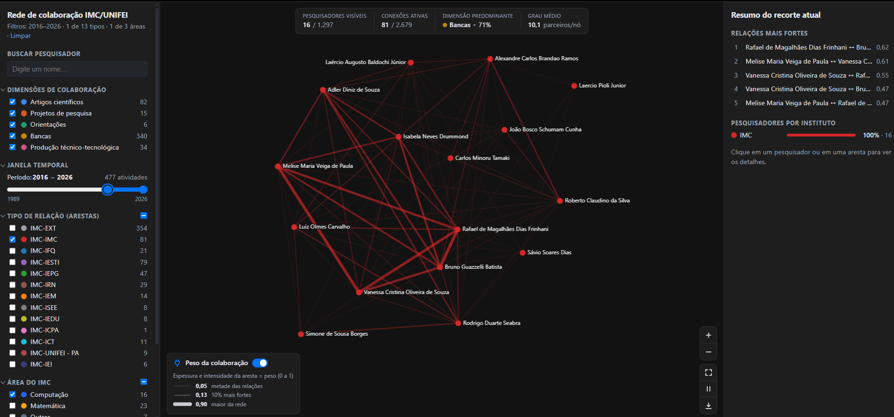
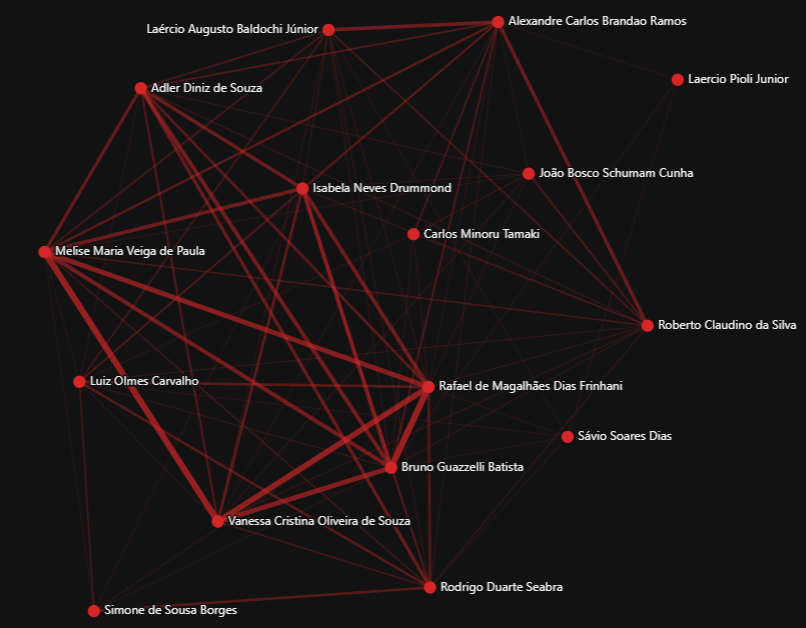

# Rede de Colaboração Científica do IMC/UNIFEI

Projeto da disciplina SMAC03 – Grafos (UNIFEI, 2º semestre de 2026), Cenário 4: Mapa do Conhecimento da
Colaboração Científica da UNIFEI.

A partir dos currículos Lattes e do SIGAA, o projeto monta a rede de colaboração dos docentes do Instituto de
Matemática e Computação (IMC) de 2016 a 2026 e a analisa com algoritmos de grafos. A colaboração não se
limita à coautoria: cada ligação reúne artigos, projetos, orientações, bancas e produção técnica.

## Modelo

- **Vértices:** pesquisadores (docentes do IMC, docentes de outros institutos da UNIFEI e pesquisadores externos).
- **Arestas:** colaboração entre dois pesquisadores, com a contagem de atividades em comum em cada uma das cinco dimensões.
- **Peso:** `W = Σ α · ln(1 + x) / ln(1 + M)`, entre 0 e 1, em que `x` é a contagem da dimensão e `M` o maior valor dela na rede.
  α: artigos 0,40, projetos 0,20, orientações 0,20, produção técnica 0,15 e bancas 0,05.
- **Camadas de análise:** (1) Computação do IMC, (2) todo o IMC, (3) IMC e outros institutos da UNIFEI, (4) rede completa, com os externos.

Algoritmos usados: BFS e DFS (componentes e classificação de arestas), Tarjan (pontos de articulação e
pontes), Dijkstra e intermediação (betweenness), coloração gulosa e teste de bipartição, e Louvain
(comunidades). As implementações próprias ficam em `Algoritmo_Final_2016/grafos_smac03.py` e são conferidas
contra o NetworkX.

## Principais resultados

- A rede tem 817 pesquisadores e 1.710 relações. Integrar as cinco dimensões revela 3,3 vezes mais relações que a coautoria sozinha.
- Computação e Matemática funcionam como duas redes separadas dentro do IMC: há só dois vínculos entre as áreas.
- O peso reduz a influência das bancas (de 47,1% das atividades para 8,9% do peso) e muda quem aparece como ponte.

## Organização

| Pasta | Conteúdo |
|---|---|
| [`rede-imc-unifei/`](rede-imc-unifei/) | Mineração dos currículos, API (FastAPI) e interface web (TypeScript) |
| [`recorte_2016/`](recorte_2016/) | Recorte dos 4 CSVs para as atividades de 2016 a 2026 |
| [`Algoritmo_Final_2016/`](Algoritmo_Final_2016/) | Análises: grupos (Q1), elos e simulação de remoção (Q2) e as quatro camadas |
| [`docs/`](docs/) | Relatório (PDF e fonte em LaTeX) e slides da apresentação |

Os dados passam pelas pastas nesta ordem:

```
rede-imc-unifei/backend/mineracao   →  backend/data/raw/          (4 CSVs, todos os anos)
recorte_2016/main.py                →  recorte_2016/resultados/   (mesmos CSVs, só 2016–2026)
Algoritmo_Final_2016/montar_base.py →  dataset_IMC_2016_2026.xlsx (base das análises)
```

A interface usa os CSVs completos e faz o recorte de anos pelo filtro de janela temporal. As análises usam
os CSVs já recortados, copiados de `recorte_2016/resultados/` para `Algoritmo_Final_2016/`.

`rede-imc-unifei/` e `Algoritmo_Final_2016/` têm READMEs com os detalhes.

## Como executar

Requisitos: Python 3.11 ou mais recente e Node.js 18 ou mais recente.

**Interface**

```bash
cd rede-imc-unifei/backend
python3 -m venv .venv
source .venv/bin/activate          # Windows (PowerShell): .venv\Scripts\Activate.ps1
pip install -r requirements.txt
python -m uvicorn src.main:app --port 8000
```

Em outro terminal:

```bash
cd rede-imc-unifei/frontend
npm install
npm run dev
```

Depois, abra <http://localhost:5173>. A mineração (`python mineracao/main.py`, dentro de `backend/`) só
precisa rodar de novo se os currículos mudarem.

**Recorte 2016–2026** (só quando a mineração mudar)

```bash
cp rede-imc-unifei/backend/data/raw/*.csv recorte_2016/dados/
python recorte_2016/main.py
cp recorte_2016/resultados/*.csv Algoritmo_Final_2016/
```

**Análises**

```bash
cd Algoritmo_Final_2016
pip install -r requirements.txt
python menu_imc.py
```

No menu, a opção 1 monta a base de 2016 a 2026 e a opção 5 roda todas as análises em sequência.

## Ilustrativo interface com o recorte da computação



## Equipe

| Integrante | Papel |
|---|---|
| Christian Ferreira Toledo | Coordenador |
| Mateus Eduardo de Padua Almeida | Modelador |
| Thiago Santos Fonseca Amaral | Modelador |
| João Pedro de Andrade Santos | Desenvolvedor |
| Leonardo Coura de Oliveira | Desenvolvedor |

Professor: Rafael Frinhani

## Licença

MIT. Veja o arquivo [LICENSE](LICENSE).
